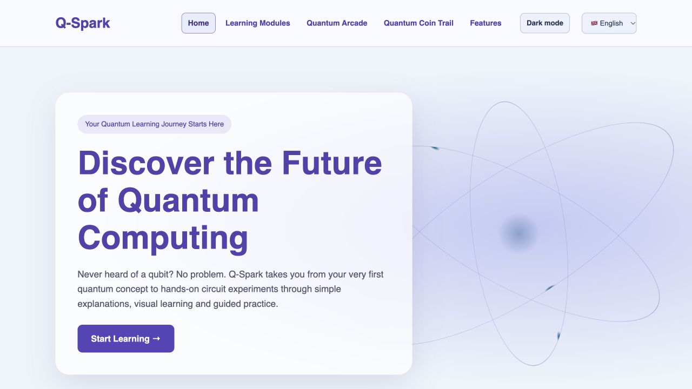
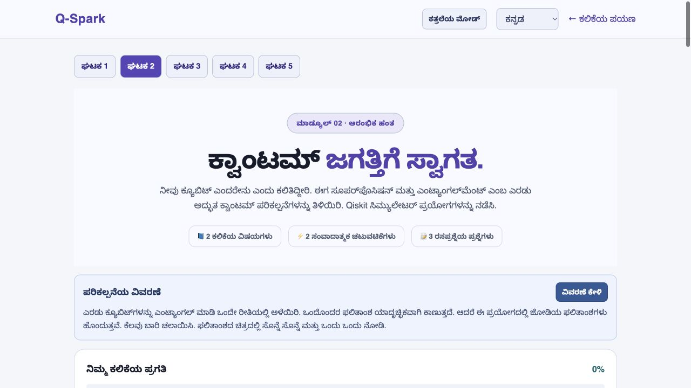
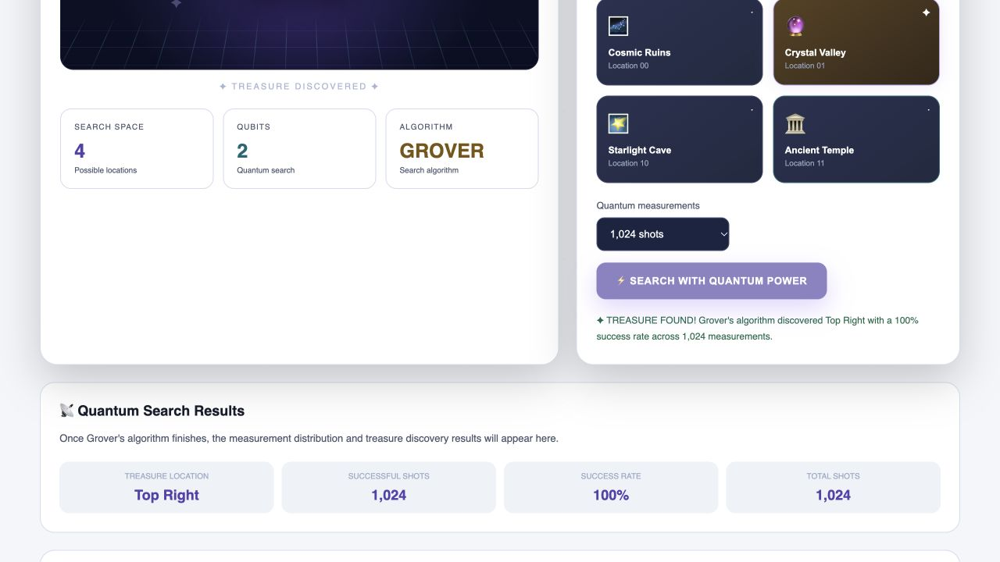
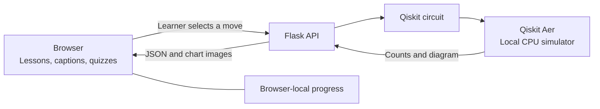

# Q-Spark

**Qiskit Fall Fest 2026 · Quantum for Humanity · Education track**

Q-Spark helps beginners build an intuition for quantum computing through familiar objects. A coin shows how measurement probabilities change. Linked dice introduce correlation. A four-box treasure hunt gives learners a way to compare Grover search with a classical guess.

The intended learners are secondary-school and early university students, including students who prefer Kannada, Telugu, or Hindi to English. A browser and a laptop are enough to run the simulator after setup.



## What learners can do

1. Open **Learning Journey** for five modules, from bits and qubits to gates, algorithms, and responsible applications. Each module has a quiz and browser-local progress.
2. Try the **Quantum Coin Trail** to flip a classical bit, measure a qubit, compare phase choices, tilt the state, and measure a pair of entangled qubits.
3. Play **Coin Lab**, **Linked Dice**, or **Treasure Hunt** in the Quantum Arcade. Controls call Qiskit Aer and show measured outcomes, circuit diagrams, or histograms.
4. Switch among **English, Kannada, Telugu, and Hindi**. The app bundles 140 narration clips across the Trail, page guides, and module concepts. Learners choose when to play audio and can read the same captions.

| Kannada lesson with narration | Treasure Hunt with live simulator results |
| --- | --- |
|  |  |

## Run Q-Spark locally

Clone the [repository](https://github.com/bommanip/q-spark-qff2026) and run these commands from `q-spark-qff2026` with Python 3.14 installed.

### macOS or Linux

```sh
python3.14 -m venv .venv
.venv/bin/python -m pip install -r requirements.txt
.venv/bin/python -m waitress --listen=127.0.0.1:8056 --threads=2 backend.app:app
```

### Windows PowerShell

```powershell
py -3.14 -m venv .venv
& .\.venv\Scripts\python.exe -m pip install -r requirements.txt
& .\.venv\Scripts\python.exe -m waitress --listen=127.0.0.1:8056 --threads=2 backend.app:app
```

Open <http://127.0.0.1:8056/>. The same server handles the pages, audio, and simulator. Press Ctrl+C to stop it.

## Results and classical comparison

Treasure Hunt encodes four boxes on two qubits. It prepares a uniform state, applies one phase-marking oracle and one Grover diffusion step, then measures both qubits. Success means the first returned box matches the marked box.

Each method gets **1,024 trials per target**, across all four targets. The classical baseline makes a uniform blind guess per trial. Its theoretical success rate is 25%. The noisy run adds 2% depolarizing noise to each CX and CZ gate. It uses an illustrative noise model on a local simulator.

| Target | Random guess | Ideal Qiskit Aer | Noisy Qiskit Aer | Circuit depth |
| --- | ---: | ---: | ---: | ---: |
| `00` | 248 | 1,024 | 997 | 12 |
| `01` | 228 | 1,024 | 994 | 12 |
| `10` | 263 | 1,024 | 993 | 11 |
| `11` | 235 | 1,024 | 992 | 10 |
| **Total** | **974/4,096 (23.78%)** | **4,096/4,096 (100.00%)** | **3,976/4,096 (97.07%)** | **10–12** |

In the activated app environment, run `python -m tools.benchmark_treasure` from the repository root. This reuses the app’s Grover circuit and checks that every ideal target is measured correctly. Depth is the Qiskit circuit depth including measurement, before hardware transpilation. The experiment demonstrates amplitude amplification for four items. It does not establish runtime advantage, and no hardware run or error mitigation is reported.

## Architecture



| Path | Purpose |
| --- | --- |
| [frontend/](frontend/) | HTML, CSS, and JavaScript for modules and games |
| [backend/app.py](backend/app.py) | Flask routes, circuit construction, and results |
| [frontend/fundamentals/](frontend/fundamentals/) and [frontend/narration/](frontend/narration/) | Captions, bundled MP3s, and playback |
| [tools/benchmark_treasure.py](tools/benchmark_treasure.py) | Reproducible classical, ideal, and noisy comparison |
| [docs/](docs/) | GitHub Pages landing page, demo screenshots, and judging notes |

## Learner evidence and pitch

Learner testing is pending. Use the short, anonymous test in the [judging guide](docs/judging.md) to record who can explain the measurement result before and after the demo. The guide also includes a three-minute recording plan and the submission checklist.

[Pitch deck](https://docs.google.com/presentation/d/1plBRwBEHsFzI0164nUXhAwoD4uV9jIAV5gVCmpI_Jvw/edit) · Three-minute pitch video link pending recording.

## Maintain the narration

The five steps each have a separate play/pause control in English (`en`), Kannada (`kn`), Telugu (`te`), and Hindi (`hi`). The browser plays the bundled MP3s from [frontend/fundamentals/audio](frontend/fundamentals/audio). Playback runs locally with no model install, account, or API key.

Edit [narration.js](frontend/fundamentals/narration.js) to update both the visible caption and the source for synthesis. Keep the order **classical**, **qubit**, **interference**, **tilt**, **entanglement**. The audio filename is `<language>-<step number>.mp3`, starting at 1. When you edit a caption, regenerate its clip and check the pronunciation before sharing it.

### Regenerate clips

Use a separate Python 3.12 virtual environment and install FFmpeg with `libmp3lame` available on PATH. These commands use an activated environment. On macOS or Linux, activate it with `source .venv-audio/bin/activate` after creating it with `python3.12 -m venv .venv-audio`. On Windows, use `py -3.12 -m venv .venv-audio` and `.\.venv-audio\Scripts\Activate.ps1`.

```sh
python -m pip install "torch>=2.4" "transformers>=5,<6" safetensors sentencepiece numpy soundfile "misaki[en]>=0.9.4" espeakng-loader phonemizer-fork "spacy>=3.8" num2words
python -m spacy download en_core_web_sm
hf download Oomni/mithi-v2-flash --revision 1fc0dd68496a2483508ec764d310146c41ff90be --local-dir ../mithi-v2-flash --exclude "assets/*"
```

The model is [Mithi v2 Flash](https://huggingface.co/Oomni/mithi-v2-flash) under Apache-2.0. The script loads the pinned model's Python runtime from `--model-dir`, uses its built-in **Vaidehi** voice on CPU, and encodes mono MP3s at 64 kbps. Keep the downloaded model and weights outside the app repository.

```sh
# Update only the Kannada interference clip
python tools/generate_coin_audio.py --model-dir ../mithi-v2-flash --language kn --step interference

# Regenerate all 20 clips
python tools/generate_coin_audio.py --model-dir ../mithi-v2-flash
```

The five modules and three arcade games also have one localized guide each. Edit [their caption scripts](frontend/narration/scripts.js) in page order: Modules 1–5, Coin Lab, Linked Dice, Treasure Hunt. Use `--scope pages` to regenerate all 32 page clips, or limit the command to a specific language and page.

```sh
python tools/generate_coin_audio.py --scope pages --model-dir ../mithi-v2-flash --language te --step linked-dice
```

For page narration the default output is `frontend/narration/audio`, with filenames such as `te-linked-dice.mp3`.

Each module also has a separate clip for every concept or activity section. Edit [the concept scripts](frontend/narration/concepts.js) under the matching concept key and language. Use `--scope concepts` to regenerate all 88 concept clips, or add filters for the clip you changed. The generator writes them to `frontend/narration/audio` using the concept key, such as `kn-module2-bell.mp3`.

```sh
python tools/generate_coin_audio.py --scope concepts --model-dir ../mithi-v2-flash --language kn --step module2-bell
```

Use `--output-dir` to preview generated files in a separate directory. The generator replaces only the selected clips in the output directory.

## License and credits

Project code is available under the [MIT License](LICENSE). [Qiskit](https://github.com/Qiskit/qiskit), [Qiskit Aer](https://github.com/Qiskit/qiskit-aer), [Flask](https://github.com/pallets/flask), and [Matplotlib](https://github.com/matplotlib/matplotlib) retain their own licenses. Narration uses [Mithi v2 Flash](https://huggingface.co/Oomni/mithi-v2-flash). The supplied ₹10 coin reference has [separate image credits](frontend/fundamentals/coin-credits.html) and its original license is unverified.
