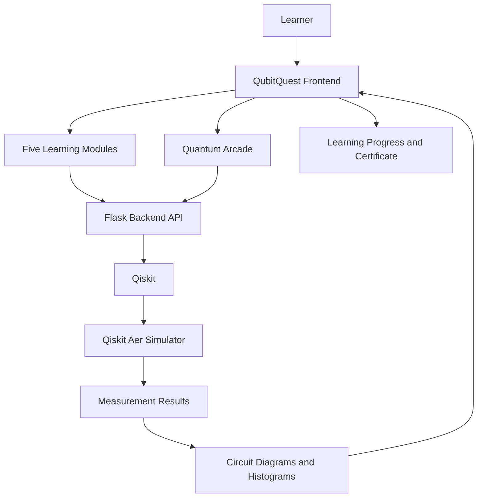

# Q-Spark | QubitQuest

### IBM Qiskit Fall Fest 2026 · Quantum for Humanity · Education Track

**Making quantum computing interactive, visual, and accessible to everyone.**

QubitQuest is an interactive quantum computing learning platform designed to help beginners explore the fascinating world of quantum technology through guided lessons, hands-on experiments, visual simulations, and interactive challenges.

Instead of learning quantum concepts through theory alone, learners can experiment with quantum circuits, observe measurement outcomes, understand quantum behaviour, and test their knowledge as they progress through the platform.

Our goal is simple: **make quantum computing easier to understand, more engaging to explore, and accessible to beginners.**

---

## ✨ Explore QubitQuest

QubitQuest combines structured learning with interactive quantum experiments.

### 1. Five Interactive Learning Modules

| Module | Learning experience |
|---|---|
| Module 1 — Quantum Computing Basics | Discover classical bits, qubits, and the foundations of quantum computing. |
| Module 2 — Superposition & Entanglement | Explore quantum superposition and understand how entangled qubits behave. |
| Module 3 — Quantum Gates & Circuits | Experiment with quantum gates and learn how quantum circuits transform qubits. |
| Module 4 — Quantum Algorithms | Discover Grover's search algorithm, Shor's algorithm, and potential applications. |
| Module 5 — Quantum for Humanity | Explore healthcare, sustainability, cybersecurity, ethics, and responsible innovation. |

Each module combines learning content, interactive experiments or activities, and knowledge assessments.

### 2. Quantum Arcade

The Quantum Arcade turns quantum concepts into playful, hands-on experiences.

**🪙 Quantum Coin Lab**

- Experiment with quantum coin flips.
- Explore different quantum rotations and phase operations.
- Compare measurement probabilities.
- Observe circuit diagrams and measurement histograms.

**🎲 Linked Dice**

- Explore independent and entangled quantum outcomes.
- Compare the behaviour of separate qubits and entangled pairs.
- Visualize quantum measurement results.
- Discover how entanglement creates correlations.

**💎 Quantum Treasure Hunt**

- Explore a four-state quantum search puzzle.
- Mark a target state using a quantum oracle.
- Apply Grover's diffusion operation.
- Observe how amplitude amplification changes the measurement outcomes.

### 3. Real Quantum Circuit Visualizations

QubitQuest connects interactive learning activities to actual Qiskit circuits executed using a local quantum simulator.

Learners can explore:

- Quantum circuit diagrams.
- Measurement counts.
- Probability distributions.
- Measurement histograms.
- Experimental outcomes.

The visualizations help connect the quantum operations performed in a circuit to the results learners observe.

### 4. Learning Progress & Assessments

- Five structured learning modules.
- Interactive multiple-choice assessments.
- Automatic score tracking.
- Module completion tracking.
- Progress saved in the browser.
- Unlockable learning milestones.
- Final assessment.

### 5. Professional Completion Certificate

Learners who successfully complete all five modules and achieve the required final assessment score can unlock their QubitQuest completion certificate.

The certificate includes:

- QubitQuest branding and quantum-inspired emblem.
- Learner's name.
- Programme completion recognition.
- Automatically generated completion date.
- Print-ready landscape layout.
- Save-as-PDF support through the browser.

---

## 🧪 Technology Stack

| Technology | Purpose |
|---|---|
| Python | Backend development |
| Qiskit | Quantum circuit creation and execution |
| Qiskit Aer | Local quantum circuit simulation |
| Flask | Backend API |
| Flask-CORS | Frontend/backend communication |
| Matplotlib | Circuit and measurement visualizations |
| HTML5 | Frontend structure |
| CSS3 | Styling and responsive layouts |
| JavaScript | Interactive experiments and frontend logic |
| Git & GitHub | Version control and collaboration |

---

## 🏗️ Project Architecture

QubitQuest uses a frontend and backend architecture.



### Project Structure

```text
Q-Spark/
│
├── backend/
│   └── app.py
│
├── frontend/
│   ├── index.html
│   ├── module1.html
│   ├── module2.html
│   ├── module3.html
│   ├── module4.html
│   ├── module5.html
│   ├── coin-lab.html
│   ├── linked-dice.html
│   └── treasure-hunt.html
│
├── docs/
│   └── index.html
│
├── requirements.txt
├── README.md
└── LICENSE
```

*The structure above highlights the main application files. Additional project files may also be present.*

---

## 🚀 Run QubitQuest Locally

### Prerequisites

- Python 3.14
- Qiskit
- Qiskit Aer
- Flask
- Flask-CORS
- Matplotlib
- A modern web browser

### 1. Clone the repository

```bash
git clone https://github.com/bommanip/q-spark-qff2026.git
```

```bash
cd q-spark-qff2026
```

### 2. Install dependencies

Create a virtual environment and install the project dependencies using the repository's `requirements.txt`.

**Windows PowerShell**

```powershell
py -3.14 -m venv .venv

.\.venv\Scripts\Activate.ps1

python -m pip install -r requirements.txt
```

**macOS / Linux**

```bash
python3.14 -m venv .venv

source .venv/bin/activate

python -m pip install -r requirements.txt
```

### 3. Start the backend

From the repository root:

```bash
python backend/app.py
```

The Flask backend runs on:

```text
http://127.0.0.1:5000
```

### 4. Start the frontend

Open another terminal:

```bash
cd frontend
```

Start the local frontend server:

```bash
python -m http.server 8000
```

### 5. Open QubitQuest

Visit:

**http://127.0.0.1:8000/**

Keep both the backend and frontend servers running while using the application.

> Note: The commands above describe the standard Python setup. On systems with a custom Python installation or package path, adjust the interpreter and environment configuration to match that installation.

---

## ⚛️ Quantum Computing Concepts Demonstrated

QubitQuest introduces several important quantum computing concepts through interactive examples.

| Concept | What learners explore |
|---|---|
| Qubits | Quantum information and measurement |
| Superposition | A quantum state containing multiple possible outcomes |
| Entanglement | Correlations between quantum systems |
| Quantum Gates | Operations that transform quantum states |
| Interference | How quantum amplitudes combine |
| Grover's Algorithm | Quantum search through amplitude amplification |
| Measurement | Observing quantum circuit outcomes |

### Quantum Simulation

The project uses Qiskit Aer to simulate quantum circuits locally.

This allows learners to experiment with quantum operations and observe measurement outcomes without requiring access to a physical quantum computer.

The simulator provides an accessible environment for learning and experimentation.

---

## 📸 Project Screenshots

Screenshots of the completed application can be added here.

Suggested screenshots:

1. QubitQuest homepage and learning dashboard.
2. Module 2 — Superposition and Entanglement.
3. Module 3 — Quantum Gates and Circuits.
4. Module 4 — Quantum Algorithms.
5. Module 5 — Quantum for Humanity.
6. Quantum Coin Lab.
7. Linked Dice.
8. Quantum Treasure Hunt.
9. Professional Completion Certificate.

*Add the screenshots to a `screenshots/` directory and link them here once they are uploaded.*

---

## 🎯 Our Vision

Quantum computing has enormous potential, but its concepts can feel intimidating to people encountering them for the first time.

QubitQuest aims to bridge that learning gap through interactive experiences that encourage curiosity, experimentation, and discovery.

We believe that understanding tomorrow's technology should not require being an expert today.

**Learn the concepts. Experiment with quantum circuits. Discover the possibilities.**

---

## 👥 Team

**Project:** Q-Spark — QubitQuest

**Event:** IBM Qiskit Fall Fest 2026

**Track:** Quantum for Humanity — Education

Add your five team members' names and their respective contributions here.

---

## 📄 License

This project is available under the [MIT License](LICENSE).

---

<p align="center">

**Q-Spark | QubitQuest**

*Making Quantum Computing an Adventure for Everyone.* ✦

</p>
