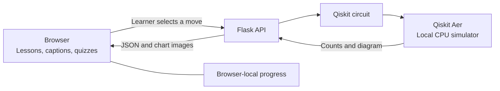
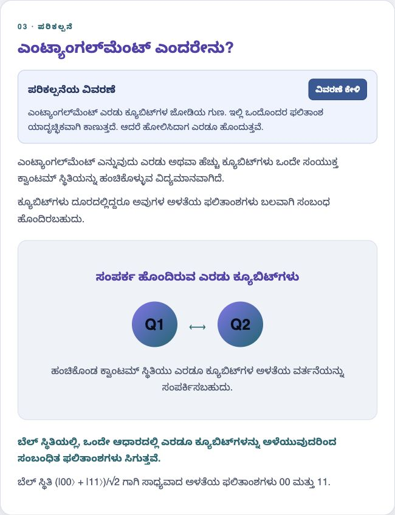
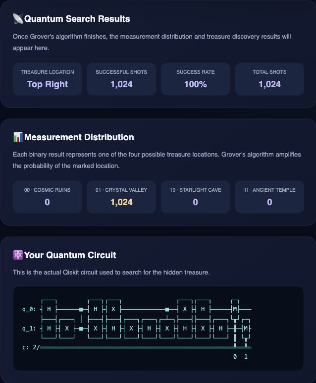
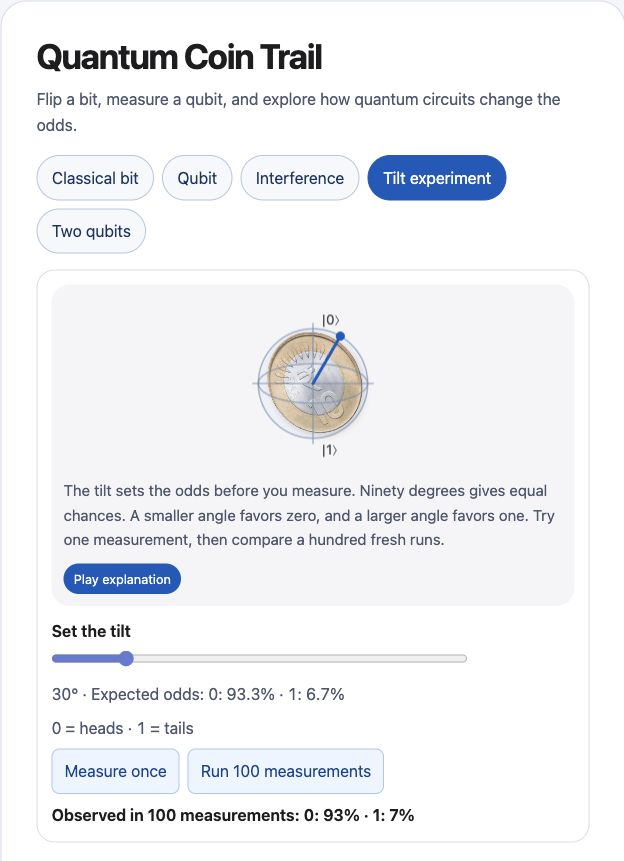

# Q-Spark

**Qiskit Fall Fest 2026 · Quantum for Humanity · Education track**

> [!IMPORTANT]
> **[Live hackathon demo](https://bommanip.github.io/q-spark-qff2026/)**
>
> GitHub Pages redirects to the temporary demo over HTTP. If prompted, tap **Continue to site**. If the demo is offline, use the local setup link below.

Q-Spark helps beginners build an intuition for quantum computing through familiar objects. A coin shows how measurement probabilities change. Linked dice introduce correlation. A four-box treasure hunt gives learners a way to compare Grover search with a classical guess.

The intended learners are secondary-school and early university students, including students who prefer Kannada, Telugu, or Hindi to English. A browser and a laptop are enough to run the simulator after setup.

[Install and run Q-Spark](docs/technical-guide.md#run-q-spark-locally) · [Pitch deck](https://docs.google.com/presentation/d/1plBRwBEHsFzI0164nUXhAwoD4uV9jIAV5gVCmpI_Jvw/edit?slide=id.qspark_pitch_1#slide=id.qspark_pitch_1)

## Architecture

Flask serves the web app and bundled translations and audio. Browser interactions call the API when they need a simulation, and Qiskit Aer returns results for the app to display.

## Three ways to learn

Q-Spark offers **localized text and on-demand audio in English, Kannada, Telugu, and Hindi**. Read the explanations or listen while you try the activities. The app bundles 140 narration clips across lessons, arcade guides, and the Coin Trail.

### Learning Journey

Work through five guided lessons, from bits and qubits to gates, algorithms, and responsible applications. Each includes a quiz and tracks progress in the browser. The example below shows a Kannada entanglement lesson with its own audio control.

### Quantum Arcade

Play Coin Lab, Linked Dice, or Treasure Hunt. This Treasure Hunt run shows the distribution from 1,024 ideal Qiskit Aer shots and the circuit that produced it.

### Quantum Coin Trail

Flip a classical bit, measure a qubit, explore interference, and compare entangled outcomes. This tilt experiment pairs a spoken explanation with a coin visual and shows predicted odds alongside 100 measured outcomes.

## Results and classical comparison

Treasure Hunt encodes four boxes on two qubits. It prepares a uniform state, applies one phase-marking oracle and one Grover diffusion step, then measures both qubits. Success means the first returned box matches the marked box.

Each method gets **1,024 trials per target**, across all four targets. The classical baseline makes a uniform blind guess per trial. Its theoretical success rate is 25%. The noisy run adds 2% depolarizing noise to each CX and CZ gate. It uses an illustrative noise model on a local simulator.

| Target | Random guess | Ideal Qiskit Aer | Noisy Qiskit Aer | Circuit depth |
| --- | ---: | ---: | ---: | ---: |
| `00` | 248 | 1,024 | 997 | 12 |
| `01` | 228 | 1,024 | 994 | 12 |
| `10` | 263 | 1,024 | 993 | 11 |
| `11` | 235 | 1,024 | 992 | 10 |
| **Total** | **974/4,096 (23.78%)** | **4,096/4,096 (100.00%)** | **3,976/4,096 (97.07%)** | **10–12** |

The four-box experiment demonstrates amplitude amplification with an illustrative noise model. See the [benchmark instructions](docs/technical-guide.md#reproduce-the-treasure-hunt-benchmark) to reproduce the run.

## Learner evidence and pitch

Learner testing is pending. Use the short, anonymous test in the [judging guide](docs/judging.md) to record who can explain the measurement result before and after the demo. The guide also includes a three-minute recording plan and the submission checklist.

## License and credits

Project code is available under the [MIT License](LICENSE). [Qiskit](https://github.com/Qiskit/qiskit), [Qiskit Aer](https://github.com/Qiskit/qiskit-aer), [Flask](https://github.com/pallets/flask), and [Matplotlib](https://github.com/matplotlib/matplotlib) retain their own licenses. Narration uses [Mithi v2 Flash](https://huggingface.co/Oomni/mithi-v2-flash). The supplied ₹10 coin reference has [separate image credits](frontend/fundamentals/coin-credits.html) and its original license is unverified.
